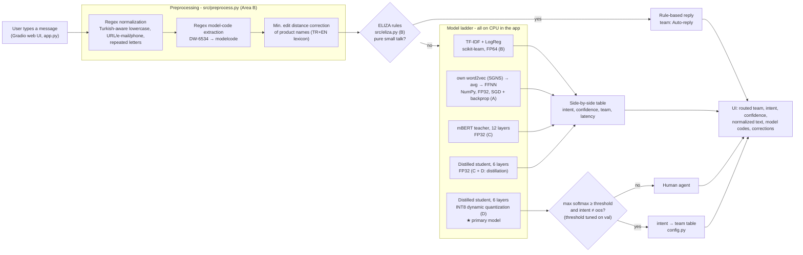

# Architecture

**Where it runs.** Training: Google Colab (T4 GPU for the Transformers, CPU for the rest).
Inference / app / latency benchmark: CPU only (Colab CPU or a laptop). Weights are downloaded
from the Hugging Face Hub into `models/` on first start.

| Component | File | Model / precision |
|---|---|---|
| Normalization, model codes, edit distance | `src/preprocess.py` | rules |
| Small-talk replies | `src/eliza.py` | rules |
| Baseline | `src/classical.py::TfidfLR` | tf-idf (word 1-2 + char 2-5) + logistic regression |
| Neural network | `src/word2vec.py`, `src/ffnn.py` | SGNS word2vec 100-d → FFNN 512 hidden, FP32 |
| Transformer | `src/transformer.py::finetune_teacher` | bert-base-multilingual-cased, FP32 |
| Distilled student | `src/transformer.py::distill_student` | 6-layer mBERT, FP32 |
| Quantized student | `src/transformer.py::quantize_student` | 6-layer mBERT, INT8 (dynamic) |
| Routing | `src/router.py`, `config.py` | threshold + lookup table |
| UI | `app.py` | Gradio |
